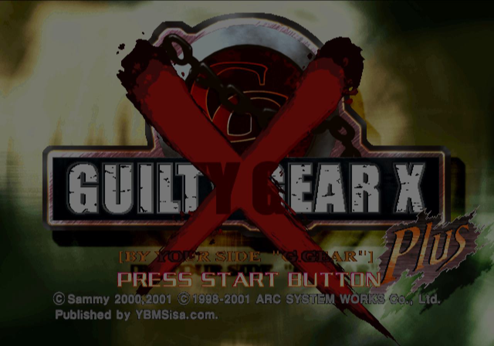
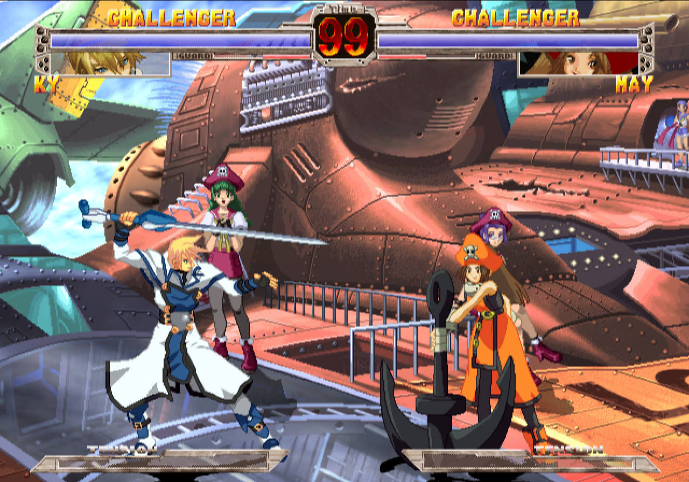

# Guilty Gear X Plus

[](https://github.com/devin-thomas/guilty-gear-x-plus/actions/workflows/progress.yml)
[](LICENSE)
[](progress/SLPS_201.37/report.json)
[](progress/SLPM_645.25/report.json)

A matching decompilation of *Guilty Gear X Plus* for the PlayStation 2. The C in `src/` compiles back to the original game, byte for byte.

## Status

**3,615 / 3,615 game functions** are C on both supported discs, and both rebuild byte-identical:

| Disc | Executable | SHA-256 |
| --- | --- | --- |
| SLPS-20137 (Japan) | `SLPS_201.37` | `8bd352acb95a533abd22f11c7f9da4a3157dc8836fc7d91ae8340bde92d8a411` |
| SLPM-64525 (Korea) | `SLPM_645.25` | `ef3278dcf50feee1da1ac423042db6a3eeeaf845a3644a1d625bb97d0024755f` |

One function, `TensionDraw`, is a tagged fake match; see [FAKEMATCHES.md](FAKEMATCHES.md). The Sony SDK and C-runtime layer in `src/sdk/` is partly C and partly assembly.

The JP/KR **code-match badges** measure byte-exact code matching in the committed objdiff reports, including SDK/runtime code; this differs from game-function C coverage. They update when you regenerate the reports and run `python scripts/progress_stamp.py write progress/stamp.json`. The existing [progress-report workflow](.github/workflows/progress.yml) checks report freshness and badge values; it does **not** rebuild the game, because disc executables are not distributed here.

## PC port

`platforms/` holds a native port of the game to **Windows 10 and 11 (64-bit)** and **macOS 14 or later on Apple Silicon**, built from this same C. It runs the game's own code, field for field as PCSX2's interpreter runs it, with the PlayStation 2 around it replaced: SDL3 for the window, controllers and sound, SDL_GPU for drawing (Direct3D 12, Vulkan or Metal). It adds an English text layer (F2), remapping, attack macros, fullscreen and integer scaling, native saves that convert to and from PCSX2 memory cards, and replays.

**Bring your own disc.** The port contains nothing from the game. On the first run it asks for an image of your own disc (ISO, BIN/CUE or CHD of SLPM-645.25 Korea or SLPS-201.37 Japan), checks it and copies its files once.

**Download** the package for your system from [Releases](https://github.com/devin-thomas/guilty-gear-x-plus/releases): `ggx-plus-1.0.0-windows-x64.zip` or `ggx-plus-1.0.0-macos-arm64.dmg`. Each holds both releases' programs, `ggx-kr` and `ggx-jp`; start `ggx-kr`, and it hands a Japanese disc over to `ggx-jp`. The packages are not signed:

- **Windows:** unzip the folder and start `ggx-kr.exe`. When SmartScreen says "Windows protected your PC", choose **More info**, then **Run anyway**.
- **macOS:** drag GGX Plus to Applications and open it. When macOS says it can't check the app, open **System Settings > Privacy & Security**, choose **Open Anyway** next to the message about GGX Plus, and confirm.

[docs/](docs/README.md) is the player's guide: installing, the disc, controls, saves, replays and settings. [platforms/README.md](platforms/README.md) explains how the port works and how to build it from source. Linux builds from source are possible but unsupported and untested.

The port's game logic, floating point included, follows PCSX2's EE interpreter exactly. The console's own float unit differs from that interpreter in the last bit of some results. Replays are tied to the version that recorded them. There is no online play yet.





## Building the decompilation

You need Linux (or WSL) on x86-64 with the 32-bit C library (Debian/Ubuntu: `libc6-i386`), Python 3.12+, and the executable from your own disc. No game data is included; see [LEGAL.md](LEGAL.md).

```sh
python3 -m venv .venv && .venv/bin/pip install -r requirements.txt
.venv/bin/python scripts/fetch_toolchain.py --dest tools  # EE-GCC and binutils; never committed
export GGX_TOOLS=$PWD/tools GGX_QEMU=                     # the i386 compiler runs directly
.venv/bin/python build.py --target jp --elf /path/to/SLPS_201.37 --work /tmp/ggx-jp \
    --binutils $PWD/tools/binutils --runner env --map /=/
.venv/bin/python build.py --target kr --elf /path/to/SLPM_645.25 --work /tmp/ggx-kr \
    --binutils $PWD/tools/binutils --runner env --map /=/
```

On a host without i386 support, set `GGX_QEMU` to a qemu-i386 command instead. Copy the executable off your disc first (it's the `SLPS_201.37` or `SLPM_645.25` file at the root of the disc image). The build checks its hash and fails on any difference from the original. The work directory must be outside a git checkout.

## Licence

The decompilation is dedicated to the public domain under [CC0 1.0](LICENSE). The port in `platforms/` is under the [MIT licence](platforms/LICENSE). Some C-runtime files in `src/sdk/`, the libraries vendored in `platforms/third_party/` and the fonts in `platforms/text/fonts/` keep their upstream terms; see [THIRD_PARTY_NOTICES.md](THIRD_PARTY_NOTICES.md). This is an unofficial fan project, not affiliated with Arc System Works or Sammy.

## Credits

The decompilation and the port are by Lil Gohan ([@gohan__FGC](https://twitter.com/gohan__FGC), [fgc.lilgohan.com](https://fgc.lilgohan.com)) and contributors.

- [WistfulHopes/ggx](https://github.com/WistfulHopes/ggx) was the first decompilation of Guilty Gear X Plus and this project's starting point. None of its code is included here, but it showed the way. Thank you, WistfulHopes.
- [decomp.me](https://decomp.me) and decompals, for the compiler archive and the toolchain.
- [nathanialf/ico](https://github.com/nathanialf/ico), for SDK and C-runtime reconstructions (MIT).
- [chaoticgd/ccc](https://github.com/chaoticgd/ccc), for the STABS reader that read the Korean disc's debug data.
- [PCSX2](https://pcsx2.net), whose interpreter is the reference the port is checked against, and [SDL](https://libsdl.org), which the port runs on.
